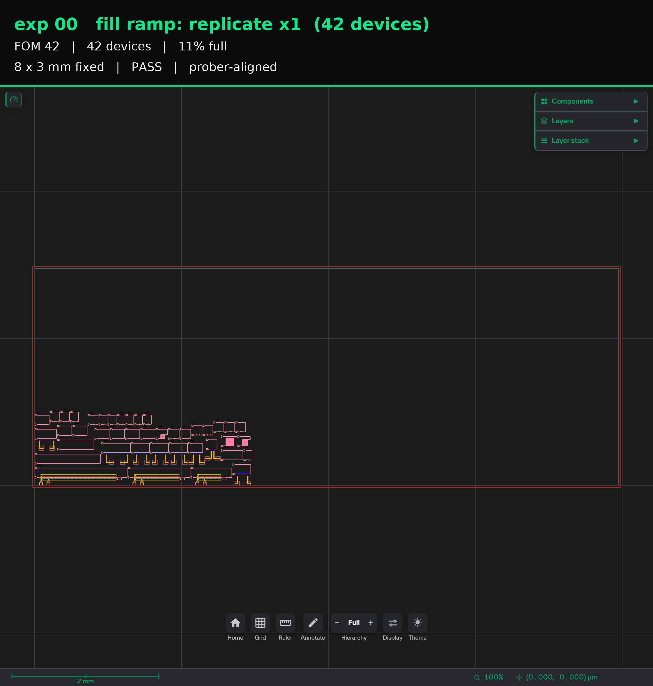

# Agentic Photonic Design: Packing a Design-of-Experiments Chip

An autonomous agent that designs and floor-plans a photonic Design-of-Experiments
(DoE) test chip. Instead of an engineer hand-tiling a multi-project-wafer (MPW)
submission, two LLM agents (e.g. Claude Code) do the job: one **plans** the
experiment (which devices to sweep, over what ranges), and a second **packs** as
many measurable, manufacturable, probeable test structures as physically fit onto
a fixed die, every one placed, routed, and design-rule clean.

Everything runs **free and local**: layout, place-and-route, geometric checks, and
the KLayout DRC deck. No cloud simulations.



## How it works

The work splits across two agents that share only a file:

1. **Planner** (`plan.py`) reads the device library and writes a DoE to
   `blackboard/doe_plan.json`: which parameter of each device to sweep, the range
   and number of points, and which devices need electrical pads.
2. **Packer** (`optimize.py`) reads that plan and tiles the die in a
   `build -> verify -> score -> journal` loop. It first ramps replicates of the
   whole DoE to capacity, then void-fills the leftover gaps with more real
   structures until no remaining gap can hold the smallest device. Every step is
   scored by a **gated** figure of merit (maximize structures placed, but score
   zero if any hard check fails) and logged to `output/journal.md`, so the
   reasoning survives across iterations.

The constraint that makes this more than rectangle packing is that every site has
to be *measurable*. Grating couplers sit at the fiber-array pitch, bond pads at the
probe pitch, and every site keeps one orientation so a wafer prober lands its fiber
array and probe card identically at each one (no rotation). A layout can be
DRC-clean and still unmeasurable; the loop checks both.

## Verification harness

The agent never grades its own homework. Each iteration is scored by an
independent set of checks in `tools/`:

| Check | What it catches |
|-------|-----------------|
| KLayout DRC (`validation.py`) | SiEPIC foundry rule deck: width, spacing, metal overlap, dicing boundary |
| Geometric collisions | exact boolean overlap of routing layers: touching sites, self-crossing routes, stray metal |
| Connectivity (LVS-style) | every site's optical path realized, no dangling ports |
| Orientation gate | every site shares one pose (the wafer-prober rule) |
| Largest-empty-rectangle | where to pack next, and when the die is full |

## Project structure

| Path | Role |
|------|------|
| `program_planner.md` | Instructions for the planner agent (Phase 0) |
| `program.md` | Instructions for the packer agent (Phases 1 and 2) |
| `plan.py` | Planner: designs the DoE, writes `blackboard/doe_plan.json` |
| `optimize.py` | Packer: fills the fixed die, streams the journal, builds the GIF |
| `tools/` | Device library (`library.py`), PCells (`components.py`), site builder (`test_structures.py`), floorplanner (`floorplan.py`), validation, scoring, inspection |
| `components_gds/` | User-supplied GDS devices (the demo ships a 1x2 Y-branch) |
| `blackboard/die.yaml` | The fixed die and rules (human-editable) |
| `output/` | Generated: per-step layouts, journal, results, evolution GIF |

## Setup

```bash
pip install photonforge siepic-forge klayout numpy matplotlib pillow
```

PhotonForge uses your Flexcompute account; configure credentials once:

```bash
tidy3d configure --apikey=YOUR_API_KEY
```

Get a key at [tidy3d.simulation.cloud](https://tidy3d.simulation.cloud). This loop
is fully local and consumes no cloud credits.

Optional, to capture the live-view frames and stitch the evolution GIF, also
install Playwright; without it the loop runs headless and skips the frames:

```bash
pip install playwright && playwright install chromium
```

## Running

Run the two phases directly:

```bash
python plan.py                       # Phase 0: design the DoE -> blackboard/doe_plan.json
python optimize.py                   # Phases 1-2: pack the fixed die -> output/
python make_gif_from_frames.py 1.8   # optional: stitch the evolution GIF
```

Or hand the whole job to an agent:

```bash
claude "Read program_planner.md and run the planner, then read program.md and pack the die."
```

Watch progress in `output/journal.md` and `output/results.tsv`. Preview the device
library or any packed step in the PhotonForge LiveViewer with `view_pcells.py` and
`view_last.py`.

## Bring your own devices

The loop never hard-codes a device list; it reads a library. To run the same loop
on your own devices, edit `default_library()` in `tools/library.py`:

```python
lib["my_pcell"] = pcell_source("my_pcell", my_factory, measures="...", primary_param="length")
lib["my_gds"]   = gds_source("my_gds", "components_gds/my_device.gds", measures="...")
```

A PCell is any `@photonforge.parametric_component` factory, swept by argument; a
GDS device is loaded and given ports by auto-detection. Both flow through the same
plan, pack, and verify loop.
```
