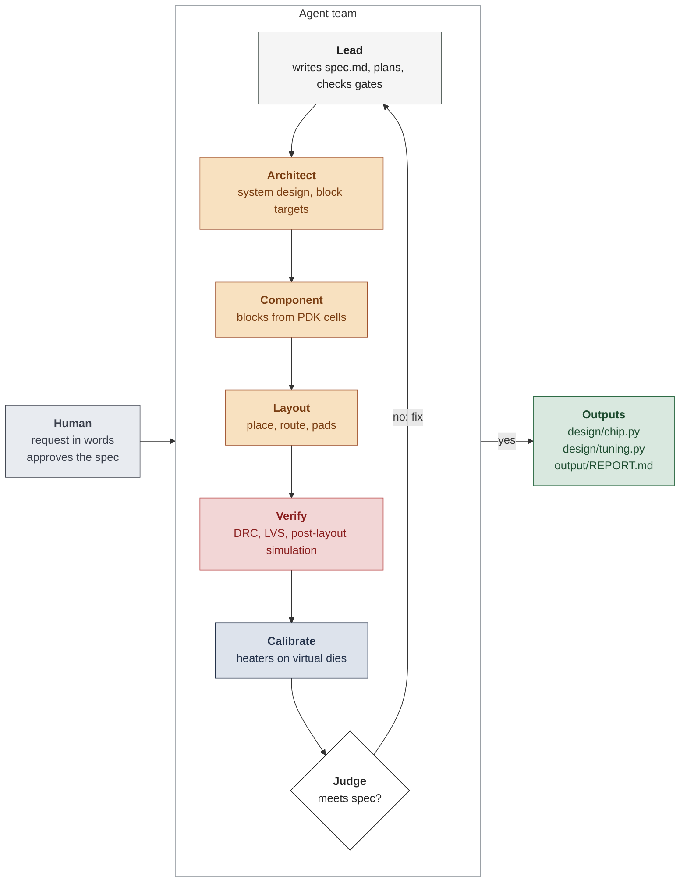

# Agent Team: Design a Full Photonic Chip

A team of AI agents designs a full photonic chip from a request in words. The team does the
system design, the components, the layout and routing, DRC and LVS, the post-layout circuit
simulation, and the heater calibration on virtual dies. One lead agent plans and checks the work.
Four specialist agents do the work.

The example chip is a tunable 2-channel lattice demux in the O-band on SiPhoPDK. It has flat-top
pass bands at 1310 nm and 1315 nm. Heaters set the phases of the lattice and correct the variation
between dies.

## How the agent team works



The human writes the request. The lead writes the spec (`spec.md`) from the request, and the human
approves the spec. Then the specialists do the work in phases. A gate closes each phase. The judge
does a check of each gate. If a gate fails, the lead sends each problem to the agent that owns the
file. The agents share their work only through files in `team/`.

## Requirements

The harness and the agents obey these requirements.

1. The spec gives each target as a number. The tools read the numbers from `spec.md`.
2. A gate passes only on evidence in a file. A message from an agent is not evidence.
3. The chip passes only when the post-layout response meets each target in the spec. DRC and LVS
   alone are not sufficient.
4. The judge does its own runs of the checks. The judge does not change the design.
5. The calibration routine uses only measurements from the test station. It does not read the
   errors of a die.
6. The final check uses new random dies at each run. These dies are not the training dies.
7. Only the owner of a file changes the file. No agent changes `spec.md` after the approval.
   No agent changes `tools/`.
8. The checks run on this computer. They do not use cloud simulations.

## Difference from `main`

| | `main` | `agent_team` |
|---|---|---|
| Agents | one agent | a lead and four specialists (`agents/`) |
| Work | one device geometry | a full chip: system, blocks, layout, calibration |
| Shared memory | `journal.md`, `principles.md` | files in `team/`: targets, achieved values, reviews, journal, lessons |
| Pass or fail | one metric from FDTD | gates in `tools/verify.py`: build, DRC, LVS, nominal post-layout performance, blind virtual dies |
| Simulation | Tidy3D FDTD in the cloud | PhotonForge circuit simulation on this computer (FDTD only for a part with no model) |
| Score | the agent scores its own work | a judge agent and frozen tools score the work |

## Use the agent team

1. Make a Python environment and install the packages:

   ```bash
   python -m venv .venv && source .venv/bin/activate
   pip install "photonforge>=2.0" tidy3d-extras pyyaml scipy matplotlib
   pip install siphopdk-forge
   ```

2. Open a coding agent in this folder. The agent must have shell and Python access, and it must
   support sub-agents. Give it a prompt with your request. For example:

   ```text
   Follow program.md. Request: build a tunable 2-channel lattice filter in the O-band
   with 5 nm channel spacing.
   ```

3. The lead writes `spec.md` from the request. It shows a table of the targets and the default
   values that it selected. Read the table. Approve the spec, or change the values.
4. The team does the work. To see the progress, use these files:
   - `python tools/team.py status`: the phases, the gates, and the last journal lines.
   - `output/verify.png`: the spectra of the last check.
   - `team/reviews/`: the decisions of the judge.
5. At the end, read `output/REPORT.md`. The layout is in `design/chip.py`. The calibration routine
   is in `design/tuning.py`.

If you do not give a request, the lead uses the current `spec.md`.

## Use the agent team for a different chip

The harness does not contain lattice-specific code. For a different chip:

1. Give a different request. The lead writes a new `spec.md` (the template is `specs/lattice_demux_2ch.md`).
2. If the spec needs a metric that `tools/metrics.py` does not have, add the metric function.
3. If the chip uses a different PDK, add a PDK adapter `tools/pdks/<pdk>.py` (technology, cells,
   DRC, LVS, models for route pieces).

The harness is applicable to passive and thermally tuned circuits that have PDK models. Examples
are ring filters, switch meshes, splitter trees, and transceiver passives. The harness does not
support these chips yet: electro-optic modulators (they need charge and RF simulations), specs
with eye diagrams (they need a time-domain metric), and parts with no model (they need FDTD for
each part, which uses FlexCredits and time).

## Files

| Path | Function |
|---|---|
| `program.md` | instructions for the lead: phases, gates, rules |
| `spec.md` | the request, the function, and the numbers that the tools read |
| `specs/` | example specs (templates) |
| `agents/` | instructions for the specialists: `architect`, `component`, `layout`, `judge` |
| `design/chip.py` | `build()` returns the chip layout (owner: layout) |
| `design/tuning.py` | `calibrate(station)` returns the heater settings (owner: architect) |
| `design/components/` | new PCells, only if no PDK cell can do the function |
| `team/` | shared files: plan, principles, targets, achieved values, reviews, journal, lessons |
| `tools/verify.py` | the gates; writes `output/verify.json` and `output/verify.png` |
| `tools/measure.py` | virtual test station: dies, heaters, measured spectra with noise |
| `tools/spec_check.py` | checks the numbers in `spec.md` and prints the targets |
| `tools/metrics.py` | metric functions |
| `tools/routing.py` | optical routing that keeps LVS correct |
| `tools/team.py` | journal, status of the phases, cloud cost |
| `tools/pdks/siphopdk.py` | PDK adapter |
| `tools/noclouds.py` | stops cloud runs in the checks |
| `tools/view.py` | shows the layout in the PhotonForge LiveViewer |
