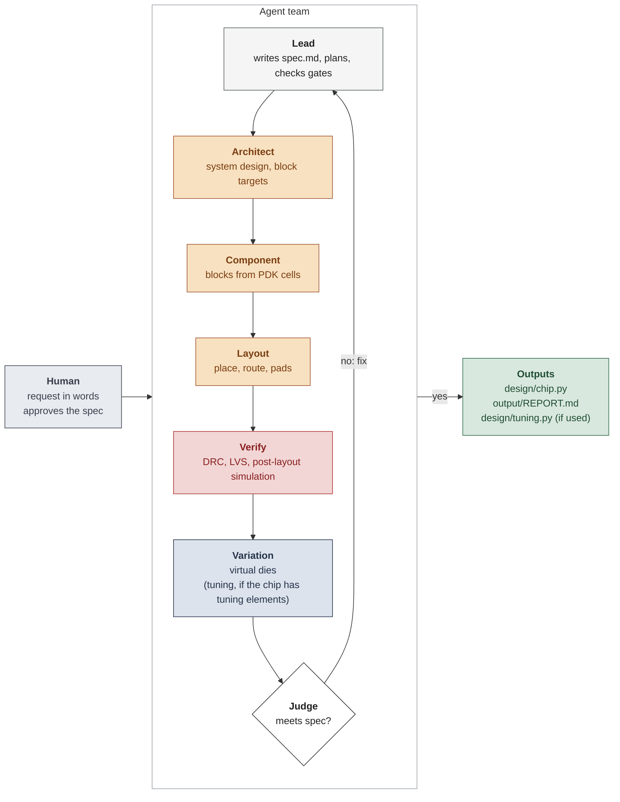

# How the Agent Team Works

The agent team is a group of AI agents that designs a full photonic chip from a request in words.
The team does the system design, the components, the layout and routing, DRC and LVS, and the
post-layout circuit simulation. Then it does a check of the chip on virtual dies with fabrication
variation. If the chip has tuning elements (for example, heaters), the team also writes the tuning routine.

One lead agent writes the spec, plans the work, and checks the gates. Four specialist agents do the
design work.

## The flow



1. The human writes a request in words.
2. The lead writes the spec (`spec.md`) from the request. The human approves the spec.
3. The specialists do the work in phases. A gate closes each phase.
4. The judge does a check of each gate.
5. If a gate fails, the lead sends each problem to the agent that owns the file.
6. When the judge accepts the final gate, the lead writes the report.

The agents share their work only through files in `team/`.

## The agents

| Agent | Work | Files that it owns |
|---|---|---|
| Lead | writes the spec, plans, sends tasks, checks gates, writes the report | `spec.md`, `team/plan.md`, `output/REPORT.md` |
| Architect | selects the topology and its numbers, writes a target for each block, writes the tuning routine if the chip has tuning elements | `team/principles.md`, `team/targets/`, `design/tuning.py` |
| Component | makes each block meet its target from PDK cells; makes a new cell only if no PDK cell can do the function | `team/achieved/`, `design/components/` |
| Layout | floorplan, placement, optical and metal routing, pads; DRC and LVS clean | `design/chip.py` |
| Judge | does its own check of each gate; does not change the design | `team/reviews/` |

The instructions for the lead are in `program.md`. The instructions for each specialist are in `agents/`.

## The gates

| Gate | After | Evidence |
|---|---|---|
| A | system design | the judge runs the system simulation again; the block targets meet the spec with margin |
| B | blocks | each block meets its target; the judge does one characterization of each block again |
| C | layout | `tools/verify.py --gates build,drc,lvs` passes; the judge looks at the layout |
| final | full check | `tools/verify.py` passes all gates, with new random dies; the judge reads the plots and the code |

`tools/verify.py` does these checks in sequence:

1. build: the chip has the ports and the size in the spec.
2. drc: the DRC rules of the PDK give 0 violations.
3. lvs: the layout agrees with the netlist.
4. nominal: the post-layout circuit simulation meets the nominal targets.
5. dies: the chip meets the die targets on new random virtual dies. If the chip has tuning
   elements, the tuning routine runs on each die first.

## Requirements

1. The spec gives each target as a number.
2. A gate passes only on evidence in a file. A message from an agent is not evidence.
3. The chip passes only when the post-layout response meets each target in the spec. DRC and LVS
   alone are not sufficient.
4. The judge does its own runs of the checks. The judge does not change the design.
5. The final check uses new random dies at each run.
6. If the chip has tuning elements, the tuning routine uses only measurements from the virtual test
   station. It does not read the errors of a die.
7. Only the owner of a file changes the file. After the approval, no agent changes `spec.md`.
   No agent changes `tools/`.
8. The checks run on this computer. They do not use cloud simulations.

## The spec

The spec is one file, `spec.md`. It has these sections:

- Request: the words of the human.
- Function: what the chip does.
- Defaults: the values that the request does not give, with the reason for each value.
- Numbers: a `yaml` block that the tools read. It gives the PDK, the ports, the targets, the
  variation, and (only for a chip with tuning elements) the tuning limits.

`tools/spec_check.py` does a check of the numbers and prints the targets for the approval of the human.

## Use the agent team

1. Go to this folder. Make a Python environment and install the packages:

   ```bash
   cd agent_team
   python -m venv .venv && source .venv/bin/activate
   pip install "photonforge>=2.0" tidy3d-extras pyyaml scipy matplotlib
   pip install <path>/siphopdk_forge-1.0.0-py3-none-any.whl   # SiPhoPDK is not on PyPI yet
   ```

2. Open a coding agent in this folder. The agent must have shell and Python access, and it must
   support sub-agents. Give it a prompt with your request. For example:

   ```text
   Follow program.md. Request: build a tunable 2-channel lattice filter in the O-band
   with 5 nm channel spacing.
   ```

3. The lead writes `spec.md`. It shows the targets and the defaults. Read them. Approve the spec, or change the values.
4. The team does the work. To see the progress, use these files:
   - `python tools/team.py status`: the phases, the gates, and the last journal lines.
   - `output/verify.png`: the spectra of the last check.
   - `team/reviews/`: the decisions of the judge.
5. At the end, read `output/REPORT.md`. The layout is in `design/chip.py`.

If you do not give a request, the lead uses the current `spec.md`.

## Use the agent team for a different chip

The agents and the tools do not contain code for one chip type. For a different chip:

1. Give a different request. The lead writes a new `spec.md` from a template in `specs/`.
2. If the spec needs a metric that `tools/metrics.py` does not have, add the metric function.
3. If the chip uses a different PDK, add a PDK adapter `tools/pdks/<pdk>.py` (technology, cells,
   DRC, LVS, and models for the route pieces).

Two examples were tested:

| Chip | Tuning | Result of `tools/verify.py` |
|---|---|---|
| 2-channel lattice demux (`specs/lattice_demux_2ch.md`) | 2 heaters | all gates pass; tuning on each die |
| 1x2 splitter between grating couplers | none | all gates pass; no tuning routine |

The harness is applicable to passive circuits and thermally tuned circuits that have PDK models.
Examples are filters, splitter trees, switch meshes, and transceiver passives. The harness does not
support these chips yet:

- electro-optic modulators (they need charge and RF simulations),
- specs with eye diagrams (they need a time-domain metric),
- parts with no model (they need FDTD for each part, which uses FlexCredits and time).

## Files

| Path | Function |
|---|---|
| `program.md` | instructions for the lead: spec, phases, gates, rules |
| `spec.md` | the active spec |
| `specs/` | example specs (templates) |
| `agents/` | instructions for the specialists |
| `design/chip.py` | `build()` returns the chip layout |
| `design/tuning.py` | `calibrate(station)` returns the tuning settings (only for a chip with tuning elements) |
| `design/components/` | new PCells, only if no PDK cell can do the function |
| `team/` | shared files: plan, principles, targets, achieved values, reviews, journal, lessons |
| `tools/verify.py` | the gates; writes `output/verify.json` and `output/verify.png` |
| `tools/measure.py` | virtual test station: virtual dies, tuning settings, measured spectra with noise |
| `tools/spec_check.py` | checks the numbers in `spec.md` and prints the targets |
| `tools/metrics.py` | metric functions |
| `tools/routing.py` | optical routing that keeps LVS correct |
| `tools/team.py` | journal, status of the phases, cloud cost |
| `tools/pdks/siphopdk.py` | PDK adapter |
| `tools/noclouds.py` | stops cloud runs in the checks |
| `tools/view.py` | shows the layout in the PhotonForge LiveViewer |
