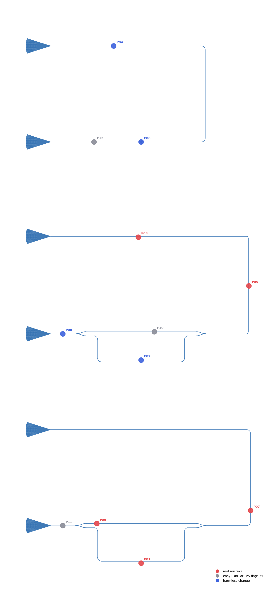
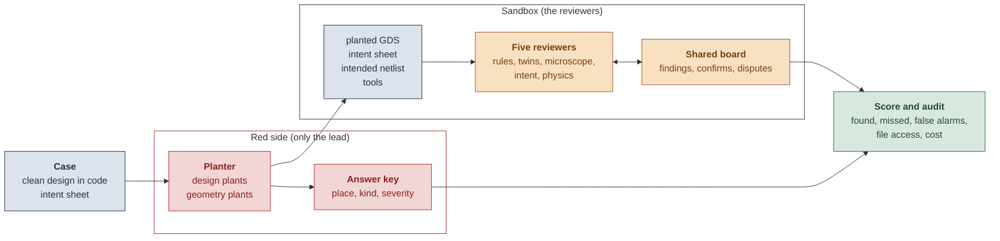
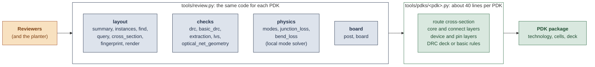
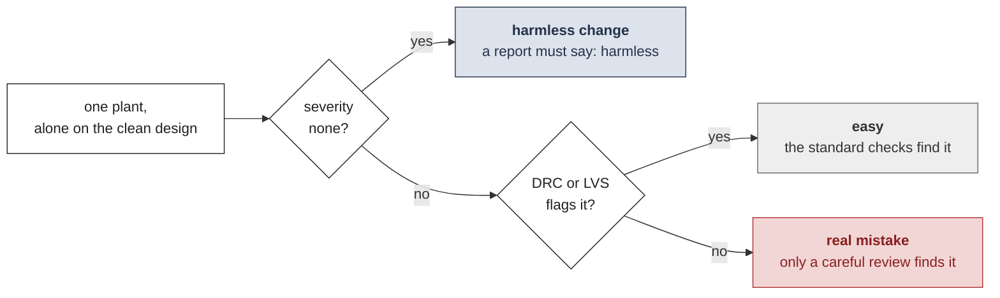
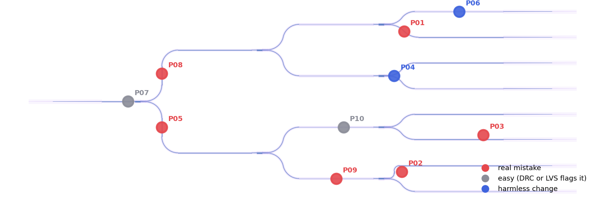
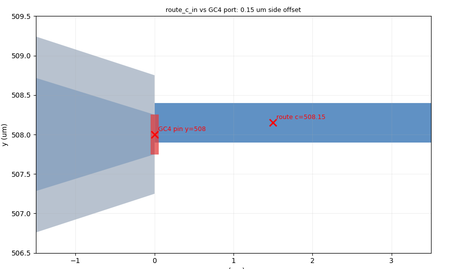
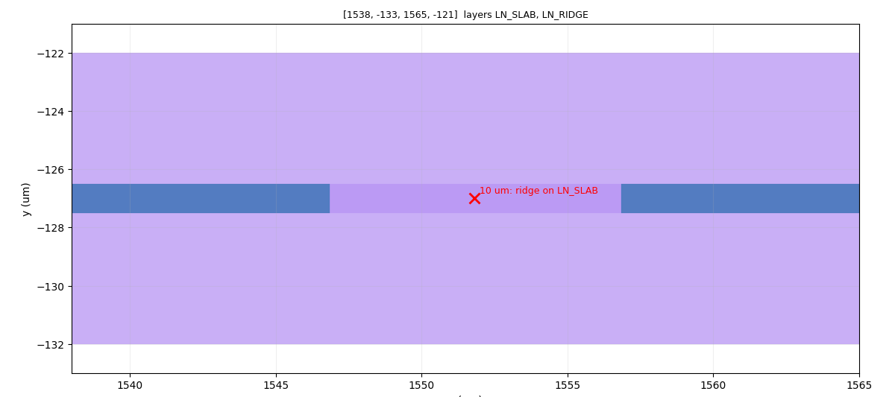

# Needle in a haystack: an AI review of a chip layout before tapeout

A team of five AI reviewers looks for mistakes in a photonic chip layout. We plant the mistakes. DRC and LVS do not
find most of them. The reviewers do not see the list of mistakes.

The tools are general. One small file per PDK gives the PDK facts that the tools need. We tested the same tools and
the same reviewers on three PDKs: SiPhoPDK (silicon, O-band), SiEPIC EBeam (silicon, C-band) and Luxtelligence LNOI400
(thin-film lithium niobate, C-band).



## The flow



1. A case builds a clean design in Python and gives its intent sheet.
2. The planter changes the design: some plants change the design values, some plants change the geometry.
3. The planter runs the PDK checks on each plant alone. A plant that DRC or LVS flags is an easy one.
4. The sandbox gets the planted layout, the intent sheet, the intended netlist and the tools. Nothing else.
5. Five reviewers work at the same time. They post findings to one board and check the findings of the others.
6. The score compares the board with the answer key. The audit reads every tool call of each reviewer.

## What the reviewers get

| In the sandbox | Not in the sandbox |
|---|---|
| the planted layout (`chip/haystack.gds`) | the clean layout |
| the intent sheet (`chip/DESIGN_INTENT.md`) | the answer key |
| the intended netlist (`chip/intent_nets.json`) | the planter and the case code |
| the tools (`tools/review.py`) and one PDK file | any other folder of the computer |

## The tools are general



The tools find all the PDK facts in the adapter file. The three test PDKs are different in each fact that matters:

| Adapter field | SiPhoPDK | SiEPIC EBeam | LNOI400 |
|---|---|---|---|
| route cross-section (`ROUTE_SPEC`) | `SI_STRIP_O`, 400 nm strip | `TE_1550_500`, 500 nm strip | `RWG1000`, 1 um rib on a slab |
| layers that join an optical net (`CONNECT`) | SI, SLAB | Si, Si Slab | LN_RIDGE only (the slab runs under every route) |
| device marker (`DEVICE_LAYER`) | DEVREC | DevRec | none: cells are found by name |
| pin marker (`PIN_LAYER`) | PINREC | PinRec | none: pins are found from the geometry |
| DRC (`drc_deck()`) | the PDK deck | the SiEPIC KLayout deck, run in batch | none: basic width and space check |

With no pin layer, `review.py` finds the pins with `Component.detect_ports` on the route cross-section. With no DRC
deck, it runs a width and space check with the numbers in the adapter. With a deck, `photonforge.drc_check` runs it.
The mode solver builds the cross-section from the PDK port spec, so a width change, an offset, a bend or a piece on
another layer is solved the same way for every PDK.

## The plants

| Kind of plant | Where it comes from | Examples |
|---|---|---|
| design plant | the case lists knob values for its `build()` | wrong delay length, a grating off its pitch, a tight bend, a legal radius that makes one path shorter, a turned crossing, a moved MMI |
| geometry plant | the planter edits a random straight piece of a random route; the same code for every PDK | a neck, a side offset, a width change, a piece on the wrong layer, a gap |

The planter sets the severity from physics, with the local mode solver of the PDK cross-section:

| Loss on the path | Severity |
|---|---|
| more than 1 dB, a dead path, or a circuit that does not do its function | high |
| 0.1 to 1 dB | medium |
| 0.05 to 0.1 dB, or a rule broken with a smaller loss | low |
| less than 0.05 dB and no rule broken | none (a harmless change) |



The same mistake can be easy on one PDK and hidden on another. On SiEPIC EBeam, the KLayout deck flags a 150 nm side
offset (a space violation at the step). On SiPhoPDK, a 120 nm offset passes DRC. The planter finds this out for each
plant; the case does not say it.

## Results

Three runs, the same five reviewer instructions, Claude Opus 5.5 for every reviewer. The first run used chip-specific
tools; the other two used the general tools in this folder.

| Run | PDK | Chip | Plants: mistake / easy / harmless | Mistakes found | Easy found | Harmless reported as defects | Severity as the key | All mistakes found by | Review time | Tool calls | API cost |
|---|---|---|---|---|---|---|---|---|---|---|---|
| quantum graph chip (first run, chip-specific tools, hand-picked plants) | SiPhoPDK | 15.8 x 9.3 mm, 3,119 cells | 8 / 4 / 6 | 8 / 8 | 4 / 4 | 0 / 6 | 10 / 12 | 16 min | 58 min | 322 | $35 |
| [`siepic_mzi_loopback`, seed 7](results/siepic_mzi_loopback_s7/) | SiEPIC EBeam | 0.3 x 0.7 mm, 23 cells | 5 / 3 / 4 | 5 / 5 | 3 / 3 | 0 / 4 | 7 / 8 | 8.3 min | 21 min | 222 | $21 |
| [`lnoi400_mmi_tree`, seed 11](results/lnoi400_mmi_tree_s11/) | LNOI400 | 2.7 x 0.9 mm, 31 cells | 6 / 2 / 2 | 6 / 6 | 2 / 2 | 0 / 2 | 5 / 8 | 10.7 min | 26 min | 201 | $23 |

The cost is the API list price of the tokens in the reviewers' transcripts (cache reads are most of it). Every
simulation ran on this computer: no cloud credits. The audit of each run found no file access outside the sandbox.



The reviewers make their own pictures with the tools. Two of them, from the runs:

| A 150 nm side offset where a route meets a grating coupler (SiEPIC) | 10 um of the ridge drawn on the slab layer (LNOI400) |
|---|---|
|  |  |

Where the team and the key do not agree on the severity, the team was right more often than the key:

| Plant | Key | Team | Why |
|---|---|---|---|
| SiEPIC: two 2 um bends | low (radiation only: 0.001 dB) | medium (0.13 dB) | the team added the mode mismatch where a bend meets a straight; the planter now does this too (`rv.bend_loss`) |
| LNOI400: a 0.5 um gap in the ridge | high (the planter rates every gap high) | medium (0.1 to 0.7 dB) | on a rib waveguide the slab stays under the gap, so most of the light gets across |
| LNOI400: a 367 um straight 0.6 um wide | low (0.06 dB) | medium | the team also found a delay error: the narrow section is equal to 6.6 um of extra path, and the intent asks for equal paths |
| LNOI400: a legal 100 um radius that makes one path 2.3 um short | medium | low | a judgment: no loss, but the length rule is broken |

What the runs show:

- The same tools and the same instructions found every planted mistake on two new PDKs, with no change to the code
  between the runs.
- A PDK with no DRC deck and no pin layers (LNOI400) did not stop the review.
- On the small chips, one or two reviewers found every plant in about 10 minutes. The other reviewers spent their time
  on confirmations and on better loss numbers. For a small chip, a team of three can be enough.

## Use it

1. Make a Python environment with PhotonForge 2.0, Tidy3D with `tidy3d-extras` (the local mode solver), KLayout, shapely
   and the PDK package. For SiEPIC EBeam, install the SiEPIC EBeam PDK in KLayout too (it has the DRC deck).
2. Open a coding agent in this folder. The agent must have shell and Python access, and it must support sub-agents.
   Give it a prompt. For example:

   ```text
   Follow program.md. Case: cases/siepic_mzi_loopback. Seed: 7.
   ```

3. The lead plants the mistakes, makes the sandbox, starts the five reviewers, then scores and audits the run.
4. Read `<RED>/REPORT.md`, `<RED>/score.json` and the board in the sandbox.

To review a real layout without plants, skip the planter: write `chip/chip.json` next to your GDS
(`{"gds": ..., "top": ..., "pdk": ..., "intent_nets": ...}`), copy `tools/review.py` and your PDK file, and start the
reviewers.

## Add a PDK

Write `tools/pdks/<pdk>.py` with the names in `tools/pdks/__init__.py`. Then check it on a clean design of that PDK:

```python
import review as rv
rv.configure("clean.gds", "top_cell", "<pdk>")
rv.extraction()      # every device pin must be in a net; nothing dangling
rv.drc()             # clean
rv.modes()           # the fundamental TE mode of the route cross-section
```

## Add a case

Write `cases/<case>/case.py` with `PDK`, `TOP`, `KNOBS`, `PLANTS`, `INTENT` and `build(**knobs)`. The clean build
must pass DRC and must have no unconnected pins. The two cases here are examples.

## Files

| File | What it does |
|---|---|
| `program.md` | the instructions for the lead |
| `agents/*.md` | the instructions for the five reviewers |
| `tools/review.py` | the review tools (the only tools in the sandbox) |
| `tools/pdks/*.py` | one adapter per PDK |
| `tools/make_sandbox.py` | makes the sandbox from a planter output |
| `tools/red/plant.py` | plants the mistakes, sets severities, runs the PDK checks per plant, writes the answer key |
| `tools/red/score.py` | compares the board with the answer key |
| `tools/red/audit.py` | reads the reviewers' transcripts: file access, tool calls, API cost |
| `tools/red/plant_map.py` | draws the plants on the chip |
| `results/` | the answer key, the score, the audit and the full board of each run |
| `cases/siepic_mzi_loopback/` | SiEPIC EBeam: two unbalanced MZIs and a loopback through a crossing |
| `cases/lnoi400_mmi_tree/` | LNOI400: a 1 x 8 MMI splitter tree with edge couplers |

## Limits

- The reviewers are only as good as the intent sheet. A rule that the intent sheet does not give is not checked.
- The case author writes the design plants. The geometry plants come from a fixed catalogue at random places. A
  separate red-team agent that writes new kinds of plants is the next step.
- The mode solver gives junction and bend losses from mode overlap. It does not give reflections or coupling between
  routes. A severity near a limit can need an FDTD run.
- The planter rates every gap as high. On a rib waveguide a short gap in the ridge costs much less, because the slab
  stays under it. The planter needs a model of the light across a gap.
- The isolation is by instruction. The audit shows each file access after the run.
